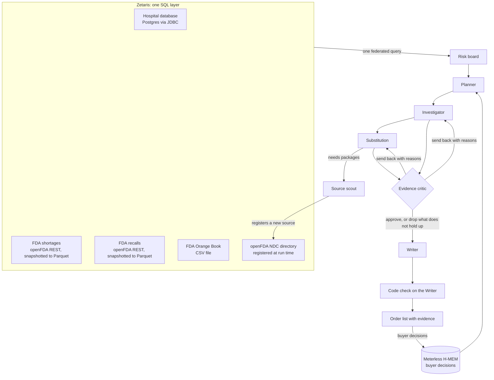

# Shortage Watch

**An agent that tells a hospital pharmacy buyer which drugs are about to run short, why, and what to order instead, with every claim linked to the FDA record behind it.**

Open Agent Hackathon 2026, **Track 02: The Agent That Can Explain Why**. Team Solus (solo).

Every Monday a hospital buyer checks the FDA shortage list by hand, compares it with what is on the shelf, and phones wholesalers to find a product that can safely replace one that is gone. Shortage Watch does that investigation and shows its work: what is running low, whether the FDA lists *our own package* as short or recalled, how long the gap is, and which interchangeable product (FDA-rated equivalent, same concentration, not short or recalled on its own packages) can be ordered, package by package, with the labeler named.

## What it found on real data

Sample hospital stock on real FDA-listed products; real FDA data captured 22 October 2026. RESULTS_TABLE

Teach it a rule and the next run changes: "Never use Hikma" removes Hikma's products in code before the Substitution agent ranks anything, the critic re-checks it, and the card says which rule was applied.

## How it works



1. **Risk board (one federated Zetaris query).** A single SQL statement joins the hospital's Postgres stock and days of cover with the FDA shortage and recall snapshots and the FDA Orange Book file (`src/tools/board.ts`, about 1 second for 45 items). It flags which of *our own packages* are short or recalled.
2. **Planner.** Code sets the floor: every item under 14 days of cover and every item whose own package is short or recalled is checked. The Nemotron planner orders that work by urgency and may add items; its additions are checked too.
3. **Investigator.** Reads the item's records through Zetaris. "Ours" means our exact package or product NDC; other presentations from our maker and other makers' shortages are reported as market context, never as our risk. Risk is set in code from those records; the model explains it with citations. The FDA's next-delivery and recovery dates for our package are parsed for the stockout gap.
4. **Source scout.** Snapshots the live openFDA views into Parquet inside Zetaris at the start of a run (fast, and kind to openFDA's rate limits). When a supply problem needs package-level data, it registers a new Zetaris REST source over the openFDA NDC directory for that ingredient, snapshots it, and queries it.
5. **Substitution.** Orange Book equivalents (same ingredient and dosage form, TE code A*), each judged on *its own packages at our concentration*: on the shortage list, recalled, or clear. Suppliers the buyer ruled out are removed in code before the model ranks. The model picks and explains; code fills the package NDCs (closest presentation first, labeler named) and adds notes for a preservative difference or a different vial size.
6. **Evidence critic.** Code checks first: every citation exists in this run; substitutes are A-rated, safe on their own packages, at our concentration, the NDCs belong to that application, and not ruled out by the buyer; days-of-cover figures match the database. Then a Nemotron model checks each claim against the records it cites. It sends work back with reasons (up to two retries), drops unsupported sentences (and any substitute whose justification fell), or blocks the item.
7. **Writer, then a code check on the Writer.** Actions, orders, gaps and numbers come from code. The model writes the headline and two sentences; code checks every number and date in them against the line's records and replaces the text with the approved claims if anything is unsupported.

Every step is written to a JSONL trace (agent, action, input and output summaries, evidence ids, critic verdict, retry count, the model that answered and, through Meterless, its receipt). Example traces from judged runs are in `runs/`.

## Sponsor technology

| Sponsor | Role in Shortage Watch |
|---|---|
| **Zetaris** | The only data layer. Sources registered by `zetaris/setup/*.sql`: openFDA shortages and recalls as REST tables (paged) with flattening views, the Orange Book as a CSV file table, the hospital Postgres database as a JDBC datasource. Each run materialises the live views to Parquet in Zetaris storage, runs one federated query across four sources (the risk board), and the source scout registers new REST sources at run time. Agents query nothing but Zetaris. |
| **Meterless** | **Nightshift** is implemented as the app's primary AI provider per provider contract v4 (`src/llm/meterless.ts`: bearer token, `meterless-app`, `meterless-scope`, model discovery, online/unauthorized/offline status, auto-detect, connect links, receipts). `npm run meterless:check` passes the contract checks against a running Nightshift. **H-MEM** (Meterless reference implementation, vendored unchanged under Apache-2.0) is the buyer memory: decisions stored with provenance in the long-term layer, re-injected every run, older run notes superseded, every change in the append-only trust ledger. `test/memory.test.ts` tests the user-facing feature end to end on a real H-MEM store; `npm run hmem:conformance` runs Meterless's own suite (13/13). PROVIDER_NOTE |
| **NVIDIA** | Nemotron does all the language work. Two lanes are seated in Nightshift: Nemotron 3.5 Lightning (30B) and Nemotron 3 Ultra (550B). The planner, investigator and substitution steps ask for `meterless/fast`; the critic and writer ask for `meterless/deep` with more reasoning. Nightshift picks the lane per call and its receipt names the model, which the trace records. With `LLM_PROVIDER=nvidia` the app calls NVIDIA's API directly (Lightning for fast steps, Ultra for deep ones). |
| **Cursor** | See "How it was built". |

## Quick start (sample mode, no credentials)

```bash
git clone https://github.com/tahcin/shortage-watch.git
cd shortage-watch
npm install
cp .env.example .env
SAMPLE_MODE=true npm start      # http://127.0.0.1:5180
```

Sample mode replays a recorded live run through the real agent code: every Zetaris result and every model reply is replayed from `samples/`, so the planner, critic loop, guards and memory all run, and every trace line says `"mode": "sample"`. Press "Check this week's orders", then "Never use Hikma" on a result, then check again to see the memory change the outcome. Command line: `SAMPLE_MODE=true npm run agent`.

## Full live setup

Needs Docker with 8 GB for Zetaris, Node 22+, Meterless Nightshift and a free NVIDIA API key.

1. **Zetaris**: install locally (zetaris.github.io/getting-started); create an API key under Management > API Tokens.
2. **Orange Book**: download the "Orange Book Data Files" zip from fda.gov and copy `products.txt` to `/home/zetaris/customer-data/shared/orangebook/products.txt` in the Zetaris driver container.
3. **Hospital database**: `HOSPITAL_DB_PASSWORD=... docker compose -f infra/hospital-db/docker-compose.yml up -d` (joins the Zetaris Docker network). Rebuild the sample data with `npm run build-sample`.
4. **Nightshift**: install from meterless.ai, add your NVIDIA key under Setup > Providers, seat Nemotron lanes, copy the Runtime API key from Console.
5. Fill `.env` from `.env.example`, then:

```bash
npm run zetaris:setup     # registers every source (idempotent)
npm run zetaris:check     # row counts per source and a cross-source join
npm run meterless:check   # Meterless provider contract checks and a test reply with its receipt
npm start                 # http://127.0.0.1:5180
```

## Tests

`npm test` runs 20 tests: strength and concentration matching, the critic's code checks (wrong-strength NDCs, NDCs from another application, unsafe substitutes, citations never fetched, days-of-cover figures, ruled-out suppliers), the Meterless provider contract, and the H-MEM buyer-memory feature end to end.

## How it was built

The rules ask for development in Cursor. The scaffold, the hospital schema and the sample-data builder were written by Cursor's agent (`cursor-agent`) from the briefs in `docs/cursor-briefs/` (commits `a135ca1`, `148a973`). The hackathon's Cursor credit had not arrived when the free plan's limit was reached on 22 October (we asked the organisers in the HackOS help desk the same day), so the rest was written with Claude Code. CURSOR_NOTE

## Data and limits

- Hospital stock, usage and purchase orders are **sample data** built on real FDA-listed products (`data/hospital/seed.sql` says so on line 1). The sample formulary deliberately includes products that are on the FDA shortage list today, so the demo has real shortages to find.
- All FDA data is real and public: openFDA drug shortages, enforcement reports and NDC directory, and the FDA Orange Book.
- Decision support only: a pharmacist reviews every order. "Interchangeable" means the FDA Orange Book TE code; "not on the FDA shortage list" is not the same as in stock at your wholesaler. Clinical alternatives (other strengths, other drugs) are left to the pharmacy team. US FDA data only.

## Pre-existing components

No application code existed before the build window (22 October 2026, 00:00 UTC). Third-party code: the Meterless H-MEM reference implementation (`vendor/meterless-hmem`, Apache-2.0, unchanged) and open-source npm packages.

## Licence

MIT (`LICENSE`). Vendored H-MEM: Apache-2.0 (`vendor/meterless-hmem/LICENSE`, `NOTICE.md`).
