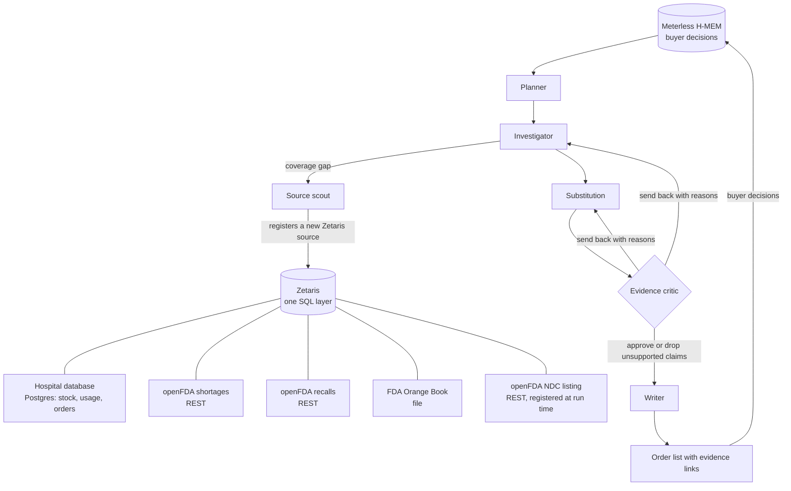

# Shortage Watch

**An agent that tells a hospital pharmacy buyer which drugs are about to run short, why, and exactly what to order instead, with every claim linked to the FDA record behind it.**

Open Agent Hackathon 2026, **Track 02: The Agent That Can Explain Why**. Team Solus (solo).

Every Monday a hospital buyer checks the FDA shortage list by hand, compares it with what is on the shelf, and phones wholesalers to find a product that can safely replace one that is gone. Shortage Watch does that investigation in a few minutes and shows its work: what is running low, whether the FDA lists it as short or recalled, and which interchangeable product (same ingredient, same strength, FDA-rated equivalent, not itself short) can be ordered, down to the package NDC.

## What it does, on real data

From a live run (sample hospital stock on real FDA-listed products, real FDA data captured 22 October 2026):

| Drug (our supplier) | Days left | What the agents found | Recommendation |
|---|---|---|---|
| Morphine sulfate 50 mg/mL (Hospira) | 5.2 | FDA lists our exact package as **Unavailable**; manufacturer reports a manufacturing delay, next delivery January 2027 | **Escalate**: the Orange Book lists no interchangeable product at this strength |
| Hydromorphone 1 mg/mL (Fresenius Kabi) | 5.2 | Our FDA application has unavailable presentations | **Add a second supplier**: Hikma ANDA216899, AP-rated, not short, NDC 0641-6169-10 (1 mg/mL only; 0.5 mg and 2 mg codes under the same application are excluded) |
| Midazolam 1 mg/mL (Hospira) | 7.4 | FDA: limited availability, demand increase | **Add a second supplier** from AP-rated equivalents that are clear of shortage and recall |
| Ketamine 10 mg/mL (Eugia) | 2.3 | Not on the shortage or recall lists | **Reorder now**: ordinary low stock, not a supply problem |

Teach it a rule ("never switch to Hikma") and the next run changes: the supplier is removed before any model sees it, and if nothing else is safe the line becomes an escalation that says why.

## How it works



- **Planner** ranks the formulary by days of cover (code guarantees every item under 14 days is checked, most urgent first) and may add items it judges risky.
- **Investigator** queries the FDA shortage and recall data for the item through Zetaris and classifies the risk. Code sets the floor: if the FDA lists our own product as limited or unavailable, it is a supply risk whatever the model says.
- **Source scout** materialises the live openFDA views into Parquet snapshots inside Zetaris at the start of a run, and when a substitute's orderable package codes are needed it registers a new Zetaris REST table over the openFDA NDC directory for that ingredient, then snapshots it.
- **Substitution** finds FDA Orange Book equivalents (same ingredient, route and concentration, TE code starting with A), checks each against the shortage and recall snapshots, removes suppliers the buyer has ruled out, keeps only package codes at our exact concentration, and asks the model to rank what is left.
- **Evidence critic** runs code checks first (every citation must exist in this run; substitutes must be A-rated, not short or recalled, at our strength, orderable, and not ruled out by the buyer; days-of-cover figures must match the database), then a Nemotron model checks each claim against the records it cites. It can send work back to the Investigator or Substitution with reasons (up to two retries), drop unsupported sentences, or block an item.
- **Writer** turns approved findings into short, plain lines. The action and order details come from code; the model only writes the words.

Every step is written to `logs/run-<id>.jsonl` (agent, action, inputs, outputs, evidence ids, critic verdict, retry count, the model that actually answered and its Meterless receipt id). Every number on the screen traces back to a record.

## Sponsor technology

| Sponsor | Role in Shortage Watch |
|---|---|
| **Zetaris** | The single data layer. One SQL query joins the hospital's Postgres database, live openFDA REST APIs and the Orange Book file. Agents query nothing else. Sources are registered by `zetaris/setup/*.sql`; the source scout registers more at run time and snapshots live APIs into Zetaris platform storage (Parquet) so a run is fast and does not hammer openFDA. |
| **Meterless** | Nightshift is the primary AI provider (provider contract v4: OpenAI-compatible Runtime, bearer token, `meterless-app`, `meterless-scope`, model discovery, status, auto-detect; see `src/llm/meterless.ts`). **H-MEM** (Meterless reference implementation, vendored under Apache-2.0) stores the buyer's decisions with provenance in its long-term layer, re-injects them every run, supersedes older run notes, and keeps an append-only trust ledger. `npm run hmem:conformance` passes 13 of 13 checks. |
| **NVIDIA** | Nemotron does the language work: Nemotron 3.5 Lightning (30B) for the fast steps with reasoning off, Nemotron 3 Ultra (550B) for the critic and writer with reasoning on, routed through Nightshift lanes. |
| **Cursor** | See "How it was built" below. |

## Quick start (sample mode, no credentials)

```bash
git clone https://github.com/tahcin/shortage-watch.git
cd shortage-watch
npm install
cp .env.example .env          # leave the placeholders
SAMPLE_MODE=true npm start    # builds the screen and serves http://127.0.0.1:5180
```

Sample mode replays a recorded live run (Zetaris results and Nemotron replies saved under `samples/`), so the whole agent loop runs and the trace says `"mode": "sample"` on every line. Or on the command line:

```bash
SAMPLE_MODE=true npm run agent -- --items 6
```

## Full live setup

Needs Docker (8 GB of memory for Zetaris), Node 22+, Meterless Nightshift and a free NVIDIA API key.

1. **Zetaris**: install locally (zetaris.github.io/getting-started), create an API key under Management > API Tokens.
2. **FDA Orange Book**: download `EOBZIP_*.zip` from fda.gov ("Orange Book Data Files") and copy `products.txt` to `/home/zetaris/customer-data/shared/orangebook/products.txt` in the Zetaris driver container.
3. **Hospital database**: `HOSPITAL_DB_PASSWORD=... docker compose -f infra/hospital-db/docker-compose.yml up -d` (joins the Zetaris Docker network). To rebuild the sample data: `npm run build-sample`.
4. **Nightshift**: install from meterless.ai, add your NVIDIA key under Setup > Providers, seat Nemotron lanes, copy the Runtime API key from Console.
5. Fill `.env` from `.env.example`, then:

```bash
npm run zetaris:setup     # registers every source (idempotent)
npm run zetaris:check     # counts per source + one cross-source join
npm run meterless:check   # provider contract checks and a test reply with its receipt
npm start                 # http://127.0.0.1:5180
```

## Tests and evidence

- `npm test`: unit tests for the safety checks (strength matching, wrong-strength NDCs, citations that were never fetched, days-of-cover figures, buyer exclusions, risk floors) and the Meterless provider contract.
- `npm run hmem:conformance`: the Meterless H-MEM conformance suite against the vendored engine.
- `logs/`: JSONL traces and results of every run; `samples/` holds the recorded run used by sample mode.

## How it was built (honest account)

- The rules ask for development in Cursor. The project scaffold, the hospital schema and the sample-data builder were written by Cursor's agent (`cursor-agent`) from the briefs in `docs/cursor-briefs/` (commits `a135ca1`, `148a973`).
- The hackathon's promised Cursor credit never arrived (HackOS "Help Cursor" channel, 22 October), and the Cursor free plan stopped after those briefs. The rest of the code was written with Claude Code (Anthropic), working from the same briefs. If credit arrives before the deadline, remaining work moves back to Cursor and this section will say so.

## Data and limits

- Hospital stock, usage and purchase orders are **sample data** built on real FDA-listed products (`data/hospital/seed.sql` says so on line 1). All FDA data is real and public: openFDA drug shortages, enforcement reports and NDC directory (CC0), and the FDA Orange Book.
- Decision support only. A pharmacist reviews every order. "Therapeutically equivalent" means the FDA Orange Book TE code; clinical alternatives (other strengths, other drugs) are left to the pharmacy team.
- US FDA data only.

## Pre-existing components

None of the application code existed before the build window (22 October 2026, 00:00 UTC). Third-party code: the Meterless H-MEM reference implementation (`vendor/meterless-hmem`, Apache-2.0, unchanged) and open-source npm packages.

## Licence

MIT. See `LICENSE`. Vendored H-MEM: Apache-2.0, see `vendor/meterless-hmem/LICENSE` and `NOTICE.md`.
